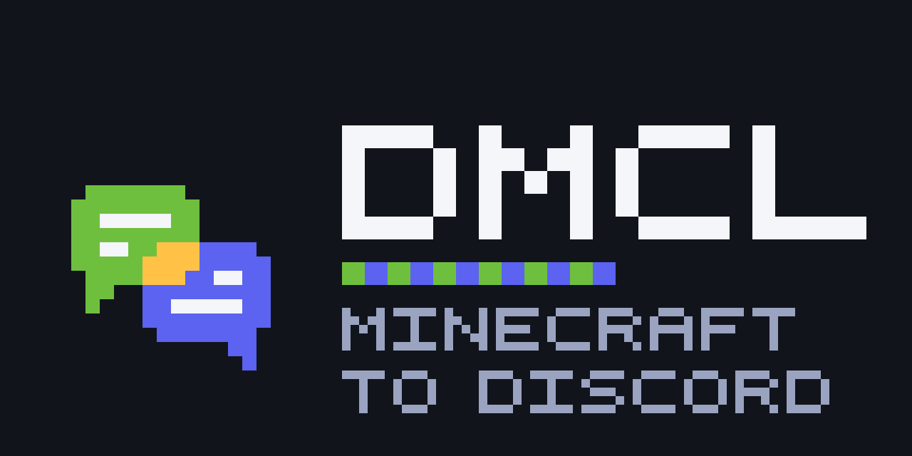

<p align="center"></p>

# DMCL

A server-side mod (Fabric, NeoForge) and Paper plugin that bridges Minecraft chat with Discord at near-native fidelity.

Each player appears in Discord as their own user (via webhook with their skin head as avatar). Discord pings reach players in game with sound and highlight. Replies, edits, attachments, embeds, custom emoji, reactions, and threads all carry across cleanly. Server events (joins, leaves, deaths, advancements, lifecycle) post as colored embeds.

## Features

- **Webhook per player.** Each MC chatter shows up in Discord as themselves: their MC name as the username, their skin head as the avatar.
- **Two way mentions.**
  - `@PlayerName` in Discord pings the linked player in game with a sound and highlighted name.
  - `@PlayerName` typed in Minecraft becomes a real `<@discordId>` mention if that player has linked their Discord account.
- **Replies** render as a quoted preview, click to jump to the original message in Discord.
- **Edits** repost as `(edited)` with italic gray styling. **Deletes** leave a small gravestone marker. Both can be disabled.
- **Attachments** become typed clickable hover text that opens in your browser:
  - Image -> `[image]` cyan
  - Video -> `[video.mp4]` cyan
  - Audio -> `[audio.mp3]` cyan
  - File  -> `[filename.ext]` cyan
- **Custom emoji** render as `:name:` in light purple.
- **Embeds** render as title plus a truncated description, one quoted line per piece.
- **Reactions** are supported, off by default.
- **Account linking** via a 6 character one time code. Run `/link` in Minecraft, paste the code into the bot's `/link <code>` slash command in Discord.
- **Configurable channel mapping.** Each scope (GLOBAL, STAFF, DEATHS, ADVANCEMENTS, LIFECYCLE) maps to its own Discord channel. Any number of `[[channels]]` entries supported.
- **Server events** relayed as colored embeds with player heads:
  - Joins (green) and leaves (gray)
  - Deaths (red) with the full vanilla death message
  - Advancements (blue / purple)
  - Server start, stop, crash (lifecycle)
- **Hexagonal architecture.** All bridge logic is pure JVM and unit tested. Only adapters touch JDA / Fabric APIs. ~85 tests covering domain, translation, orchestration, persistence, config, and JDA wiring.

## Install

1. Download the jar for your platform and Minecraft version from [Modrinth](https://modrinth.com/mod/dmcl) or the [Releases](https://github.com/HamzaQaz/dmcl/releases) page (`dmcl-fabric-<mc>`, `dmcl-neoforge-<mc>`, or `dmcl-paper`).
2. Drop it into `mods/` (Fabric also needs [Fabric API](https://modrinth.com/mod/fabric-api)) or `plugins/` (Paper).
3. Start the server once. It writes `config/dmcl.toml` with example values.
4. Stop the server, edit `config/dmcl.toml` (channel IDs, guild ID, mention rules), and provide your bot token via the `DMCL_DISCORD_TOKEN` environment variable.
5. Start the server again. Watch for `DMCL ready` in the log.

### Discord bot setup

1. Create a bot at <https://discord.com/developers/applications>.
2. Enable the **Message Content** intent under Bot settings.
3. Invite the bot with the `applications.commands` and `bot` scopes. Permissions needed:
   - View Channels
   - Send Messages
   - Manage Webhooks
   - Add Reactions
   - Read Message History

### Token

The mod reads the token from one of three places, in this order:

1. The OS environment variable `DMCL_DISCORD_TOKEN`.
2. A `KEY=VALUE` line in `config/dmcl.env`.
3. A TOML key in `config/dmcl.secrets.toml`.

Pick whichever fits your hosting. The example `config/dmcl.toml` references the env var by default.

## Configuration

The example `config/dmcl.toml` written on first start documents every option. Key sections:

- `[discord]` token, guild ID, presence
- `[storage]` SQLite location, per world or per game directory
- `[avatars]` skin head provider and image size
- `[behavior]` toggle edits, deletes, reactions, ping sound, mention color
- `[[channels]]` repeat per scope (GLOBAL, STAFF, DEATHS, ADVANCEMENTS, LIFECYCLE), each with channel ID and direction flags
- `[mentions]` allow_everyone, allow_here, allow_role list

## Commands

### In Minecraft

| Command          | Who         | What                                            |
| ---------------- | ----------- | ----------------------------------------------- |
| `/link`          | any player  | Generates a 6 character one time link code      |
| `/unlink`        | any player  | Removes your Discord link                       |
| `/dmcl status`   | op level 2  | JDA connection state and channel health summary |

### In Discord

| Command         | What                                            |
| --------------- | ----------------------------------------------- |
| `/link <code>`  | Completes a pending link from Minecraft         |
| `/unlink`       | Removes your Discord link                       |
| `/players`      | Ephemeral list of online MC players             |

## Build from source

Requires JDK 21.

```bash
./gradlew build
```

The jar lands in `build/libs/` and is auto copied to `/mnt/c/dev/mc-server/mods/` for the dev cycle (adjust the `installMod` task in `build.gradle.kts` for your own mods folder).

Run tests:

```bash
./gradlew test
```

## Architecture

Hexagonal: a pure JVM `core/` package (domain, ports, translation, orchestrator) plus three adapters (JDA, Fabric, SQLite). All translation is unit tested with no MC or JDA imports. Adapter classes wire the IO and stay small.

```
src/main/java/com/n1ghtlydev/dmcl/
├── core/                         pure JVM, no MC/JDA imports
│   ├── domain/                   records: BridgeMessage, Author, ...
│   ├── port/                     interfaces: DiscordPort, MinecraftPort, LinkRepo, ...
│   ├── translate/                McToDiscord, DiscordToMc, mention resolver, ...
│   └── orchestrator/             BridgeOrchestrator + EventBus
├── adapter/
│   ├── jda/                      JDA listener, webhook cache, slash commands
│   ├── fabric/                   server thread bridges, MC text converter
│   ├── sqlite/                   linked accounts persistence
│   └── config/                   TOML + secret resolver
├── mixin/                        advancement event hook
└── DmclMod.java                  composition root
```

Full design notes are in `docs/superpowers/specs/`.

## Modrinth

Releases are published to [Modrinth](https://modrinth.com/mod/dmcl), one version per platform and Minecraft version, each with its own release notes.

To release: add a section to `CHANGELOG.md`, bump `modVersion` in `gradle.properties`, and push a `v<version>` tag. The `release` workflow builds every target and uploads it (needs the `MODRINTH_TOKEN` repository secret). The target list lives in `scripts/gen-release-workflow.py`; rerun it after editing the list. Build a single target locally with `scripts/build-target.sh <fabric|neoforge|paper> <mc>`.

## Compatibility

| Platform | Minecraft | Java |
| --- | --- | --- |
| Fabric | 1.21.1 to 1.21.11 (every release) | 21 |
| Fabric | 26.1, 26.1.1, 26.1.2, 26.2, 26.3 | 25 |
| NeoForge | 1.21.1, 1.21.3, 1.21.4, 1.21.5, 1.21.8, 1.21.10, 1.21.11 | 21 |
| NeoForge | 26.1.2, 26.2, 26.3 | 25 |
| Paper (plugin) | 1.21 and later, one jar | 21 |

Each Minecraft version has its own jar, and its metadata only accepts that version, so a wrong download is rejected at boot instead of crashing later. Server-side only; players install nothing. Forge is not published yet. NeoForge has no stable build for 1.21.2, 1.21.6, 1.21.7 or 1.21.9, so those are Fabric-only.

## License

MIT. See [LICENSE](LICENSE).
